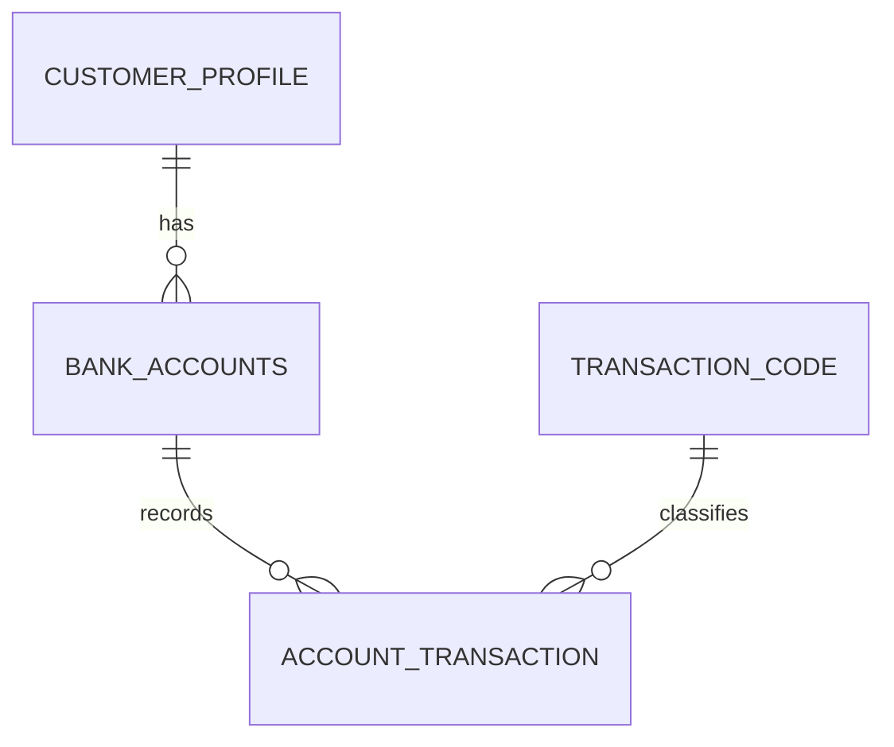

# Retail Banking SQL Analytics (Oracle)

End-to-end SQL analysis of a retail banking dataset in Oracle: data audit, cleaning views, indexing and analytical queries on **2.4 million transactions** (2020-2025).

Source: Kaggle, "Retail Banking Dataset 2020-2025" ([link](https://www.kaggle.com/datasets/subhanu/retail-banking-dataset)). The CSV files are not included in this repository.

## Dataset

| Table | Rows | Description |
|---|---|---|
| `customer_profile` | 1,000 | Customers (city, state, birth date) |
| `bank_accounts` | 3,553 | Savings, loan and fixed-deposit accounts |
| `account_transaction` | 2,377,169 | Debit and credit transactions |
| `transaction_code` | 15 | Transaction code reference |

## Repository structure

| Script | Content |
|---|---|
| `sql/01_audit.sql` | Data audit: duplicates, NULLs, orphans, categories, paired transactions |
| `sql/02_views.sql` | Cleaning view `clean_account_transaction` and analysis views |
| `sql/03_indexes.sql` | Primary keys, indexes, `EXPLAIN PLAN` before and after |
| `sql/04_functions.sql` | Aggregate, date, ranking and `LAG`/`LEAD` functions |
| `sql/05_statistics.sql` | Median, standard deviation, percentiles, correlation, outliers |
| `sql/06_subqueries_cte.sql` | Scalar, correlated and nested subqueries, calendar table |
| `sql/07_joins.sql` | INNER, LEFT, FULL OUTER and CROSS joins |

Run the scripts in order (01 to 07) in Oracle SQL Developer.

## Data audit

The audit found no duplicate IDs, no NULL or negative amounts and no orphan rows. It did find four things that change how the data must be analysed:

1. **Paired transactions.** Loan and fixed-deposit operations are written twice (one row per account), so `SUM(amount)` over all rows counts the money twice.
2. **Unsigned amounts.** Every amount is positive; the direction is stored in `transaction_type` (Debit/Credit).
3. **534 fixed-deposit openings** have no paired row (1,546 openings, 1,012 paired).
4. **845 fixed-deposit maturity pairs** have different amounts on the two sides. The cause cannot be determined from the data, so no interest income was calculated.

## Cleaning

Only the transaction table needed cleaning, so a single view was created: `clean_account_transaction`.

- `txn_category` separates real customer activity from loan, fixed-deposit and fee rows
- `signed_amount` is positive for Credit and negative for Debit
- `is_unpaired_fd_open` flags the 534 unpaired openings (they are flagged, not deleted)
- `is_system` flags rows written automatically by the bank

## Performance

An account-level query on `account_transaction` (2.4 M rows) was measured with `EXPLAIN PLAN`:

| | Before indexing | After indexing |
|---|---|---|
| Access path | `TABLE ACCESS FULL` | `INDEX RANGE SCAN` |
| Cost | 10,510 | 46 |

## Key findings

- 97.7% of rows are customer activity. Merchant payments are 42.4% of customer transactions, while interbank transfers carry about 75-77% of the spend value each year.
- Inflows exceed outflows every year (net +6.71 bn over six years). Spend growth closely follows account growth (156 savings accounts at the end of 2020, 1,000 at the end of 2025); after 2022 the spend per account stays roughly flat.
- Amounts are right-skewed: the mean is about twice the median in every transaction type. The IQR rule flags 7.7% of transactions as outliers, so a fixed high percentile is a better threshold.
- Loan amount is not correlated with interest rate (r = -0.045) or term (r = -0.008).
- The top 25% of customers produce 61.3% of total spend.
- 334 of 1,000 customers (33.4%) have no loan.

## Limitations

- Customer segments use total spend and ignore how long the customer has been with the bank.
- Many loans and deposits were opened in 2025, so their history is short.
- The meaning of `balance` on loan accounts is not documented, so it is not used.

